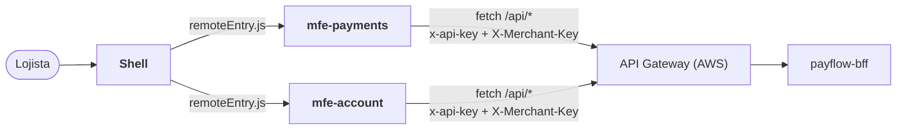

# payflow-frontend

**Microfrontend do PayFlow**: portal do lojista em **React**, dividido em um
**Shell** (host) e **remotes** carregados em tempo de execução com **Module Federation**.

Parte da plataforma PayFlow (arc42 completo no repositório de documentação
[`PayFlow`](https://github.com/CaioSeniuk/PayFlow)). Alunos: **Caio Henrique,
Gabriel Moribe, Guilherme Celente e Leonardo Berlanda** — PUCPR, Arquitetura de
Soluções com Cloud, 2026.

## O que é este repositório

A interface do lojista (SPA). Requisito da atividade atendido: _"Microfrontend —
interface do usuário (SPA) em React, responsável por consumir o BFF (não acessa
microservices diretamente)"_.

| App | Tipo | Expõe | Telas |
|---|---|---|---|
| `apps/shell` | Host | — | Layout, menu, rotas, login com a chave do lojista; carrega os remotes |
| `apps/mfe-payments` | Remote | `./PaymentsApp` | **Painel** (`/aggregated-data`), lista e filtros, detalhe, novo pagamento (cartão/PIX), estorno, cancelamento, confirmação PIX simulada |
| `apps/mfe-account` | Remote | `./AccountApp` | Dados do lojista, configuração de webhook, rotação de chave |
| `packages/ui` | Biblioteca | — | Componentes visuais compartilhados (singleton) |

Cada app tem build e publicação próprios: uma nova versão de um remote é publicada
sem recompilar o Shell.

## Relação com os outros repositórios



| Repositório | Relação |
|---|---|
| `payflow-bff` | **Único backend consumido**, sempre via API Gateway (`VITE_API_BASE_URL`). |
| Demais | Nenhuma chamada direta. Microsserviços e Functions nunca são chamados pelo navegador. |

## Tecnologias

| Item | Escolha |
|---|---|
| UI | React 18, TypeScript |
| Build | Vite 5 + `@originjs/vite-plugin-federation` |
| Monorepo interno | npm workspaces |
| Rotas | React Router |
| Dados | TanStack Query sobre `fetch` |
| Testes | Vitest + Testing Library |
| Hospedagem | Amazon S3 + CloudFront (um prefixo por app) |

## Arquitetura interna

Cada remote é organizado por funcionalidade (vertical slice no frontend):

```text
apps/mfe-payments/src/
├── features/
│   ├── dashboard/        usa GET /api/aggregated-data
│   ├── payment-list/
│   ├── payment-detail/
│   ├── create-payment/
│   └── refund/
├── shared/api-client.ts  único ponto que conhece VITE_API_BASE_URL e os cabeçalhos
└── PaymentsApp.tsx       componente exposto ao Shell
```

Convenções: `react`, `react-dom` e `@payflow/ui` são singletons compartilhados; os
MFEs se comunicam apenas por URL e eventos de navegador; não há estado global
compartilhado. A chave do lojista fica em `sessionStorage` (demonstração).

## Estado atual

Repositório novo; nada implementado.

- [ ] Workspaces `apps/shell`, `apps/mfe-payments`, `apps/mfe-account`, `packages/ui`
- [ ] Module Federation (host + 2 remotes), URLs dos remotes por variável de ambiente
- [ ] Login com chave do lojista e cliente de API
- [ ] Painel consumindo `/aggregated-data`
- [ ] Telas de pagamentos e de conta
- [ ] Testes de componentes
- [ ] Bucket S3 + distribuição CloudFront; `remoteEntry.js` com `Cache-Control: no-cache`
- [ ] GitHub Actions (build e `aws s3 sync` por app)

## Como rodar localmente (previsto)

```bash
npm install
npm run dev          # shell :5173, mfe-payments :5174, mfe-account :5175
npm test
```

### Variáveis de ambiente (build)

| Variável | Descrição |
|---|---|
| `VITE_API_BASE_URL` | URL do API Gateway (`https://<id>.execute-api.sa-east-1.amazonaws.com/prod/api`) |
| `VITE_GATEWAY_API_KEY` | Chave de cliente do usage plan (identifica o portal; não é segredo de usuário) |
| `VITE_MFE_PAYMENTS_URL` | URL do `remoteEntry.js` do mfe-payments |
| `VITE_MFE_ACCOUNT_URL` | URL do `remoteEntry.js` do mfe-account |

## Publicação

```bash
npm run build
aws s3 sync apps/shell/dist        s3://payflow-frontend/shell/
aws s3 sync apps/mfe-payments/dist s3://payflow-frontend/mfe-payments/
aws s3 sync apps/mfe-account/dist  s3://payflow-frontend/mfe-account/
aws cloudfront create-invalidation --distribution-id <id> --paths "/*/remoteEntry.js" "/shell/index.html"
```

## Links

| Item | URL |
|---|---|
| Frontend (nuvem) | _a publicar_ |
| Documentação de arquitetura | https://github.com/CaioSeniuk/PayFlow |
