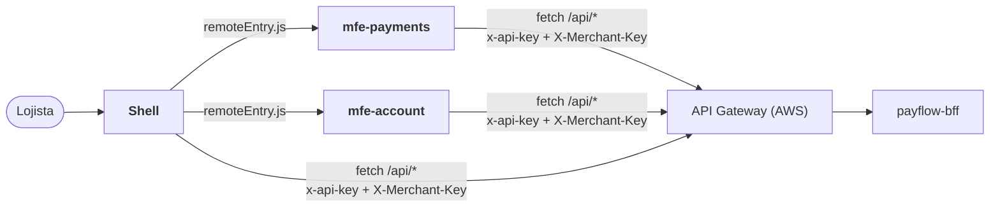

# payflow-frontend

**Microfrontend do PayFlow**: portal do lojista em **React**, dividido em um
**Shell** (host) e **remotes** carregados em tempo de execução com **Module Federation**.

Parte da plataforma PayFlow (arc42 completo no repositório de documentação
[`PayFlow`](https://github.com/CaioSeniuk/PayFlow)). Alunos: **Caio Henrique,
Gabriel Moribe, Guilherme Celente e Leonardo Berlanda** — PUCPR, Arquitetura de
Soluções com Cloud, 2026.

## O que é este repositório

A interface do lojista (SPA). Requisito da atividade atendido: _"Microfrontend —
interface do usuário (SPA) em React, responsável por consumir o BFF (não acessa
microservices diretamente)"_.

| App | Tipo | Expõe | Telas |
|---|---|---|---|
| `apps/shell` | Host (`:5173`) | — | Topo, barra lateral, rotas, **entrar** com a chave do lojista, **criar conta**; carrega os remotes |
| `apps/mfe-payments` | Remote (`:5174`) | `./PaymentsApp` | **Painel** (`GET /aggregated-data`), lista com filtros, detalhe e edição, nova cobrança (cartão/PIX), QR Code do PIX, estorno, cancelamento, confirmação PIX simulada |
| `apps/mfe-account` | Remote (`:5175`) | `./AccountApp` | Dados da loja, webhook (URL, eventos, segredo), troca da chave de acesso |
| `packages/ui` | Biblioteca | — | Componentes visuais, tokens de design e formatos brasileiros (singleton) |
| `packages/api-client` | Biblioteca | — | **Único ponto que conhece o BFF**: URL base, cabeçalhos, tipos e erros (singleton) |

Cada app tem build e publicação próprios: uma nova versão de um remote é publicada
sem recompilar o Shell.

## Relação com os outros repositórios



| Repositório | Relação |
|---|---|
| `payflow-bff` | **Único backend consumido**, sempre via API Gateway (`VITE_API_BASE_URL`). Localmente, o proxy do Vite repassa `/api/*` ao BFF. |
| Demais | Nenhuma chamada direta. Microsserviços e Functions nunca são chamados pelo navegador. |

Rotas do BFF usadas: `POST /merchants` (criar conta), `GET/PUT /merchants/me`,
`PUT /merchants/me/webhook`, `POST /merchants/me/api-key`, `GET /aggregated-data`,
`GET/POST /payments`, `GET/PATCH/DELETE /payments/{id}`, `POST /payments/{id}/refunds`
e `POST /payments/{id}/pix-confirmation`.

## Tecnologias

| Item | Escolha |
|---|---|
| UI | React 19, TypeScript 6 |
| Build | Vite 8 + `@module-federation/vite` (host + 2 remotes) |
| Monorepo interno | npm workspaces |
| Rotas | React Router 8 (o Shell é dono da URL; cada remote tem as suas sub-rotas) |
| Dados | TanStack Query sobre `fetch` (um cache por microfrontend) |
| Ícones / QR Code | Lucide, `qrcode.react` |
| Testes | Vitest + Testing Library (jsdom); regras de arquitetura com dependency-cruiser |
| Qualidade | ESLint (typescript-eslint, react-hooks), `tsc --noEmit` |
| Hospedagem | Amazon S3 + CloudFront; imagem nginx no Docker Hub para demonstração |

`@module-federation/vite` substituiu o `@originjs/vite-plugin-federation` previsto no
início: é o plugin mantido pela equipe do Module Federation e o que funciona com o Vite 8.

## Arquitetura interna

Cada app é organizado por funcionalidade (**vertical slice** no frontend). Uma fatia
não importa outra; o que é comum fica em `shared/` (remotes) ou `layout/` e `session/` (Shell).

```text
apps/shell/src/
├── features/login/            entrar com a chave (GET /merchants/me)
├── features/sign-up/          criar conta (POST /merchants)
├── layout/                    topo, barra lateral, telas de autenticação
├── session/                   chave na sessão, rota protegida, 401 → sair
├── remotes.tsx                carrega PaymentsApp e AccountApp (lazy + ErrorBoundary)
└── App.tsx                    /entrar, /criar-conta, /conta/* → account, resto → payments

apps/mfe-payments/src/
├── features/dashboard/        GET /aggregated-data
├── features/payment-list/     GET /payments (filtros na URL)
├── features/payment-detail/   GET, PATCH, DELETE /payments/{id}, confirmação PIX
├── features/refund/           POST /payments/{id}/refunds
├── features/create-payment/   POST /payments (Idempotency-Key)
├── features/pix-charge/       QR Code + copia e cola, acompanha o pagamento
├── shared/                    chaves de cache, rótulos, Idempotency-Key
└── PaymentsApp.tsx            componente exposto ao Shell

apps/mfe-account/src/
├── features/profile/          GET/PUT /merchants/me
├── features/integration/      webhook e chave de acesso
├── shared/
└── AccountApp.tsx

packages/api-client/src/       request(), ApiError, sessão, tipos, payflowApi (uma função por rota)
packages/ui/src/               componentes, styles.css (tokens), format.ts, events.ts
```

Convenções:

- `react`, `react-dom`, `react-router`, `@tanstack/react-query`, `@payflow/ui` e
  `@payflow/api-client` são **singletons compartilhados** pelo Module Federation.
- Os MFEs **não compartilham estado**: conversam pela URL e por eventos do navegador
  (`payflow:toast`, `payflow:hide-values`, `payflow:unauthorized`,
  `payflow:merchant-updated`, `payflow:payments-changed`).
- A chave do lojista fica em `sessionStorage` (demonstração). Qualquer `401` do BFF
  encerra a sessão; sair recarrega a página para limpar os caches de todos os MFEs.
- Cobranças e estornos usam uma `Idempotency-Key` por tentativa: repetir depois de
  falha de rede ou `504` reaproveita a chave; mudar o formulário gera outra.
- Um remote fora do ar não derruba o Shell: a área mostra um erro com "Recarregar".

### Testes de arquitetura (`npm run test:architecture`)

Regras do dependency-cruiser (`.dependency-cruiser.cjs`): apps não importam outros
apps; fatias não importam outras fatias; `shared/`, `layout/` e `session/` não
conhecem fatias; pacotes não importam apps; `@payflow/ui` não chama o BFF;
`@payflow/api-client` não depende de React; sem ciclos; todo import resolve (menos
os módulos remotos `mfe_payments/*` e `mfe_account/*`).

## Design

Referência visual: portal da **Stone** (verde, barra lateral com saldo e atalhos,
cartões brancos sobre fundo cinza-claro), adaptado com as regras de fintech da skill
`ui-ux-pro-max` (contraste AA, números tabulares, status com cor + texto + ícone,
foco visível, alvos de 44 px, `prefers-reduced-motion`). O plano completo está em
[`design/PLANO_DE_DESIGN.md`](design/PLANO_DE_DESIGN.md) e a prévia estática que
originou as telas em `design/preview/`.

## Estado atual

- [x] Workspaces `apps/shell`, `apps/mfe-payments`, `apps/mfe-account`, `packages/ui`, `packages/api-client`
- [x] Module Federation (host + 2 remotes), URLs dos remotes por variável de ambiente
- [x] Entrar com a chave do lojista, criar conta e cliente de API
- [x] Painel consumindo `/aggregated-data` (com avisos quando uma parte falha)
- [x] Telas de pagamentos (lista, detalhe, nova cobrança, PIX, estorno) e de conta (dados, webhook, chave)
- [x] Testes de componente e de arquitetura
- [x] Dockerfile (nginx) e GitHub Actions (lint, typecheck, testes, build; imagem e S3 em tags `v*`)
- [ ] Bucket S3 + distribuição CloudFront; publicar `v1`
- [ ] Rodar ponta a ponta com o BFF e os serviços na nuvem

## Como rodar localmente

Pré-requisitos: Node.js 22.22 ou mais novo (`nvm use` lê o `.nvmrc`) e o
[`payflow-bff`](https://github.com/g-celente/payflow-bff) rodando em `http://localhost:3000`
(veja o README dele para subir os serviços).

```bash
cp .env.example .env   # opcional: os valores padrão já servem para rodar local
npm install
npm run dev            # shell :5173, mfe-payments :5174, mfe-account :5175
```

Abra http://localhost:5173, clique em **Criar conta** (a chave aparece uma vez) e
use o portal. As chamadas vão para `/api/*`, que o Vite repassa ao BFF.

Também dá para rodar o build de produção localmente: `npm run build && npm run preview`
(mesmas portas). Cada remote sozinho: `npm run dev -w @payflow/mfe-payments` e abra
http://localhost:5174 (pede uma chave de lojista, porque fora do Shell não há sessão).

Testes e qualidade:

```bash
npm test               # arquitetura (dependency-cruiser) + componentes (Vitest)
npm run lint
npm run typecheck
npm run build          # apps/*/dist
```

### Variáveis de ambiente

Ficam no `.env` da raiz (lido pelos três apps). As `VITE_*` entram no build e vão
para o navegador; nenhuma é segredo de usuário.

| Variável | Descrição |
|---|---|
| `VITE_API_BASE_URL` | `/api` local; na nuvem, a URL do API Gateway (`https://<id>.execute-api.sa-east-1.amazonaws.com/prod/api`) |
| `VITE_GATEWAY_API_KEY` | Chave de cliente do usage plan (identifica o portal) |
| `VITE_MFE_PAYMENTS_URL` | URL do `remoteEntry.js` do mfe-payments |
| `VITE_MFE_ACCOUNT_URL` | URL do `remoteEntry.js` do mfe-account |
| `SHELL_BASE`, `MFE_PAYMENTS_BASE`, `MFE_ACCOUNT_BASE` | Onde cada app é publicado (o `base` dos remotes é absoluto ou a partir da raiz, porque os arquivos são baixados pela página do Shell) |
| `BFF_DEV_URL` | Só no proxy de desenvolvimento: endereço do BFF (padrão `http://localhost:3000`) |
| `GATEWAY_ORIGIN_SECRET` | Só no proxy: enviado como `X-Gateway-Secret` se o BFF exigir |

## Docker

Imagem de demonstração com os três apps num nginx (Shell em `/`, remotes em
`/mfe-payments/` e `/mfe-account/`) e `/api/*` repassado ao BFF:

```bash
docker build -t payflow-frontend .
docker run --rm -p 8080:8080 -e BFF_URL=http://host.docker.internal:3000 payflow-frontend
# http://localhost:8080
```

Para apontar o navegador direto para o API Gateway, passe
`--build-arg VITE_API_BASE_URL=... --build-arg VITE_GATEWAY_API_KEY=...` no build.

## Publicação (S3 + CloudFront)

Mesmo layout do contêiner: Shell na raiz do bucket, remotes em prefixos próprios.
O job `deploy` do GitHub Actions faz isso em tags `v*` (variáveis `AWS_REGION`,
`FRONTEND_BUCKET`, `CLOUDFRONT_DISTRIBUTION_ID`, `API_BASE_URL`; secrets
`AWS_ACCESS_KEY_ID`, `AWS_SECRET_ACCESS_KEY`, `AWS_SESSION_TOKEN`, `GATEWAY_API_KEY`).
Manualmente:

```bash
export VITE_API_BASE_URL=https://<id>.execute-api.sa-east-1.amazonaws.com/prod/api
export VITE_GATEWAY_API_KEY=<chave do usage plan>
export VITE_MFE_PAYMENTS_URL=/mfe-payments/remoteEntry.js VITE_MFE_ACCOUNT_URL=/mfe-account/remoteEntry.js
export MFE_PAYMENTS_BASE=/mfe-payments/ MFE_ACCOUNT_BASE=/mfe-account/
npm run build
aws s3 sync apps/mfe-payments/dist s3://<bucket>/mfe-payments/ --delete
aws s3 sync apps/mfe-account/dist  s3://<bucket>/mfe-account/ --delete
aws s3 sync apps/shell/dist        s3://<bucket>/ --delete --exclude "mfe-payments/*" --exclude "mfe-account/*"
aws cloudfront create-invalidation --distribution-id <id> \
  --paths "/index.html" "/mfe-payments/remoteEntry.js" "/mfe-account/remoteEntry.js"
```

Na distribuição CloudFront: `index.html` como objeto raiz e respostas de erro 403/404
→ `/index.html` (200), para as rotas da SPA (`/pagamentos/...`) abrirem direto.
`index.html` e `remoteEntry.js` vão com `Cache-Control: no-cache`; o resto tem hash no nome.

## Links

| Item | URL |
|---|---|
| Frontend (nuvem) | _a publicar_ |
| Documentação de arquitetura | https://github.com/CaioSeniuk/PayFlow |
